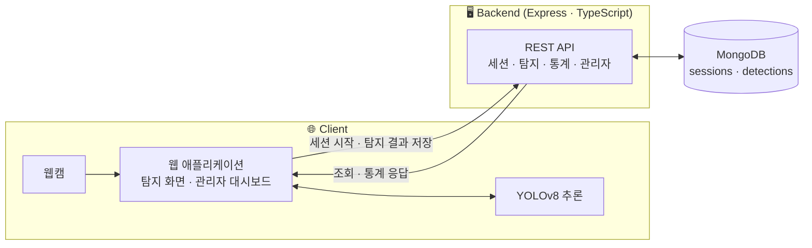
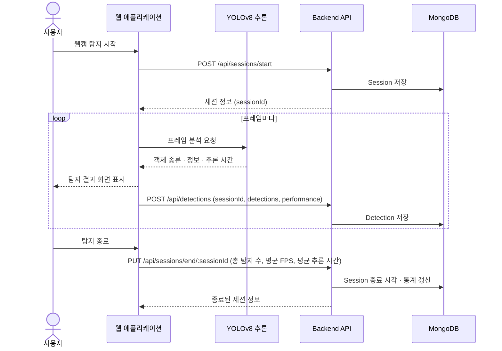
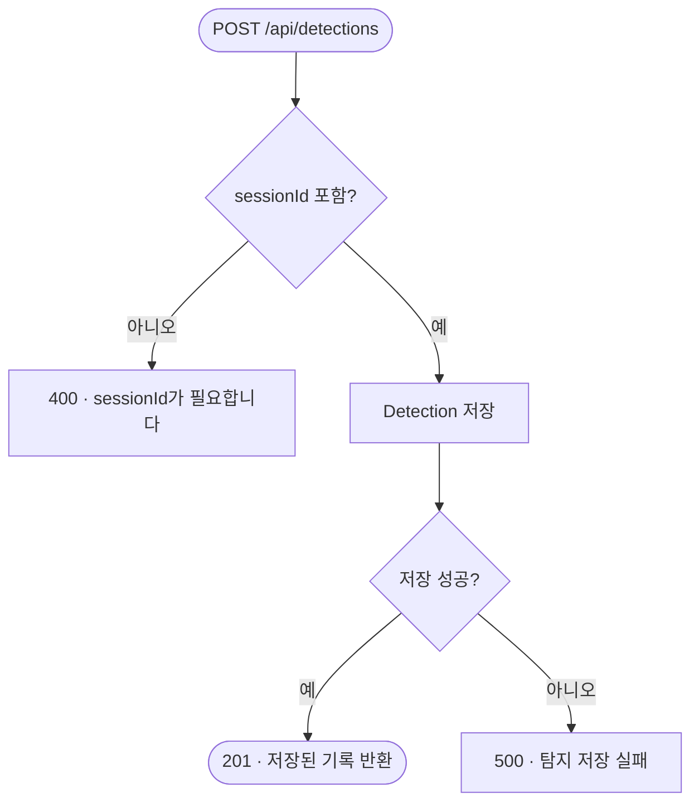
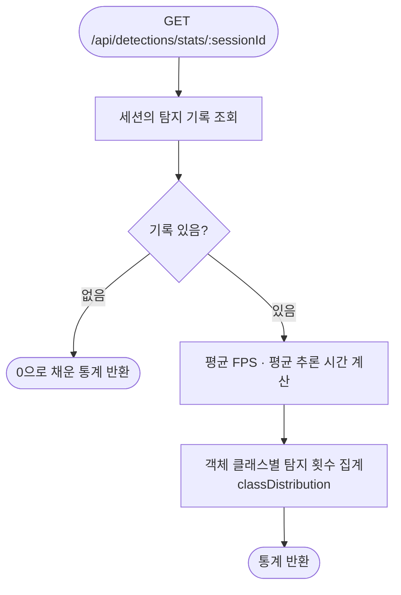
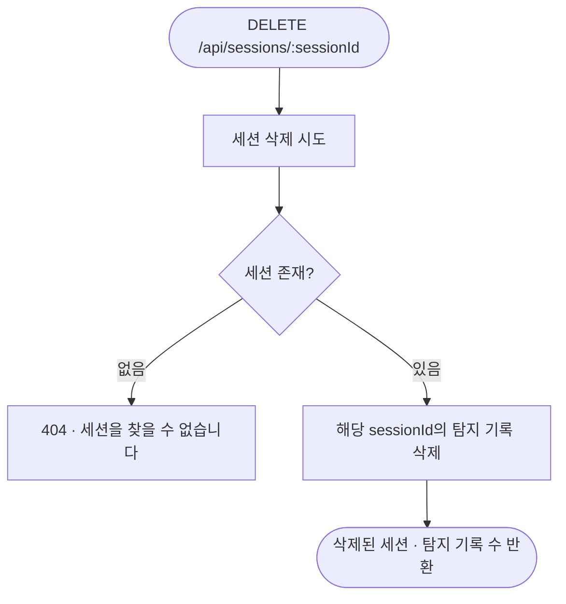
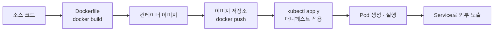
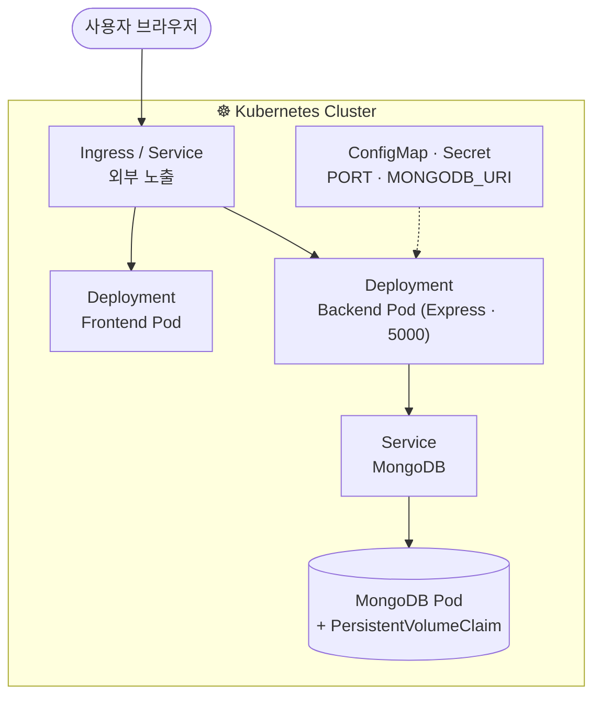

# 🎥 YOLOv8 기반 객체 탐지 및 데이터 관리 웹 애플리케이션

> 웹캠 영상을 **YOLOv8**로 실시간 분석해 객체를 탐지하고, 탐지 결과를 데이터베이스에 저장·관리하는 웹 애플리케이션입니다. **Docker 컨테이너화**와 **Kubernetes 배포·운영** 실습에 중점을 두었습니다.

---

## 📌 목차

1. [프로젝트 소개](#-프로젝트-소개)
2. [주요 기능](#-주요-기능)
3. [기술 스택](#-기술-스택)
4. [시스템 아키텍처](#-시스템-아키텍처)
5. [처리 흐름](#-처리-흐름)
6. [Docker · Kubernetes](#-docker--kubernetes)
7. [데이터 구조](#-데이터-구조)
8. [API 목록](#-api-목록)

---

## 📖 프로젝트 소개

웹캠으로 촬영되는 영상을 YOLOv8 모델로 분석해 **객체의 종류와 정보를 화면에 표시**하고, 탐지 결과를 **세션 단위로 저장**해 이후 조회·통계·삭제까지 관리할 수 있도록 구현한 간단한 프로젝트입니다.

기능 자체는 단순하게 구성하고, 다음 두 가지에 집중했습니다.

| 중점 | 내용 |
| --- | --- |
| **Docker 실습** | 애플리케이션을 컨테이너 이미지로 패키징하고 환경 변수로 설정을 주입 |
| **Kubernetes 구현** | 컨테이너를 클러스터에 배포하고, 헬스체크·종료 처리 등 운영을 고려한 구조 구성 |

---

## ✨ 주요 기능

| 분류 | 기능 |
| --- | --- |
| **실시간 탐지** | 웹캠 영상을 YOLOv8로 분석해 객체 종류·정보를 화면에 표시 |
| **세션 관리** | 탐지 시작·종료 시 세션 생성/종료, 종료 시 총 탐지 수·평균 FPS·평균 추론 시간 기록 |
| **탐지 기록 저장** | 프레임별 탐지 결과(객체 목록, FPS, 추론 시간)를 MongoDB에 저장 |
| **조회 · 통계** | 세션 목록(최근 50개), 세션별 탐지 기록, 클래스별 탐지 분포·평균 성능 통계 |
| **관리자 대시보드** | 전체 세션·탐지 수, 최근 세션 10건, 탐지 기록 전체 조회 |
| **삭제** | 개별 탐지 기록 / 세션(소속 탐지 기록 함께 삭제) / 전체 삭제 |

---

## 🛠 기술 스택

| 영역 | 기술 |
| --- | --- |
| **Frontend** | (사용한 프레임워크 작성) — 웹캠 캡처, 탐지 결과 표시, 관리자 대시보드 |
| **Backend** | Node.js, Express, TypeScript, Mongoose, cors, dotenv |
| **AI** | YOLOv8 (객체 탐지) |
| **Database** | MongoDB |
| **Infra** | Docker, Kubernetes |

---

## 🏗 시스템 아키텍처

> 추론 모듈의 실제 실행 위치(브라우저 / 별도 서버)에 맞게 다이어그램을 수정해 주세요.

---

## 🔄 처리 흐름

### 1. 실시간 탐지 · 저장 흐름

### 2. 탐지 기록 저장 검증

### 3. 세션 통계 조회

### 4. 세션 삭제 (연관 데이터 함께 삭제)

---

## 🐳 Docker · Kubernetes

> ⚠️ 이 섹션의 **리소스 구성은 일반적인 예시**입니다. 실제 `Dockerfile`과 `k8s/` 매니페스트에 맞게 수정해 주세요.

### 컨테이너 빌드 → 배포 흐름

### 쿠버네티스 구성 (예시)

| 리소스 | 역할 |
| --- | --- |
| **Deployment** | Frontend / Backend Pod 실행 및 재시작 관리 |
| **Service** | Pod 간 통신 및 외부 노출 |
| **ConfigMap · Secret** | `PORT`, `MONGODB_URI` 등 설정 주입 |
| **PersistentVolumeClaim** | MongoDB 데이터 영속화 |

### 컨테이너 환경을 고려한 서버 구현

서버 코드는 컨테이너·쿠버네티스 환경에서 동작하도록 다음과 같이 구성했습니다.

| 항목 | 구현 | 컨테이너 · K8s에서의 의미 |
| --- | --- | --- |
| **환경 변수 설정** | `PORT`, `MONGODB_URI`, `NODE_ENV`를 환경 변수로 주입 | ConfigMap · Secret · `env`로 값 교체 |
| **헬스체크** | `GET /health` — DB 연결 상태, 타임스탬프, uptime 반환 | liveness / readiness probe 대상 |
| **Graceful Shutdown** | `SIGTERM` · `SIGINT` 수신 시 서버와 DB 연결을 닫고 종료 (10초 내 미종료 시 강제 종료) | Pod 종료 시 K8s가 보내는 `SIGTERM` 처리 |
| **기동 실패 처리** | MongoDB 연결 실패 시 프로세스 종료 (`exit 1`) | 컨테이너 재시작 정책으로 재시도 (DB가 늦게 뜨는 경우 대응) |

--

## 🧭 API 목록

| Method | Path | 설명 |
| --- | --- | --- |
| GET | `/health` | 서버 · DB 상태 확인 |
| GET | `/api/users` | 사용자 목록 (데모 데이터) |
| POST | `/api/sessions/start` | 세션 시작 |
| PUT | `/api/sessions/end/:sessionId` | 세션 종료 (통계 기록) |
| GET | `/api/sessions` | 세션 목록 (최신순 50개) |
| DELETE | `/api/sessions/:sessionId` | 세션 삭제 (탐지 기록 포함) |
| DELETE | `/api/sessions` | 전체 세션 · 탐지 기록 삭제 |
| GET | `/api/detections` | 전체 탐지 기록 조회 (`limit`, 기본 50) |
| POST | `/api/detections` | 탐지 기록 저장 (`sessionId` 필수) |
| GET | `/api/detections/session/:sessionId` | 세션별 탐지 기록 조회 |
| GET | `/api/detections/stats/:sessionId` | 세션 통계 (평균 FPS · 추론 시간 · 클래스 분포) |
| DELETE | `/api/detections/:detectionId` | 개별 탐지 기록 삭제 |
| DELETE | `/api/detections/all` | 전체 탐지 기록 삭제 |
| GET | `/api/admin/stats` | 관리자 통계 (세션 수 · 탐지 수 · 최근 세션) |

---

--
